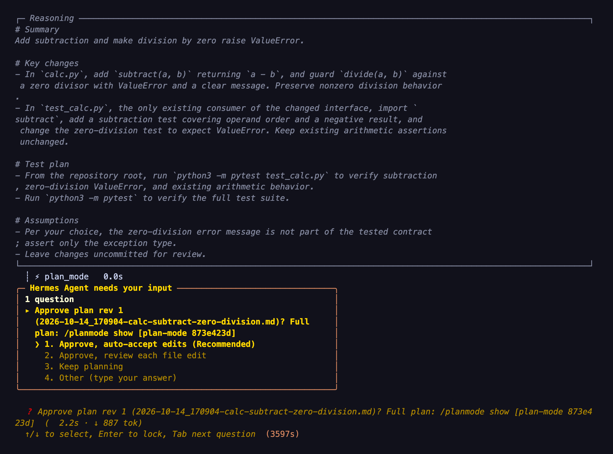
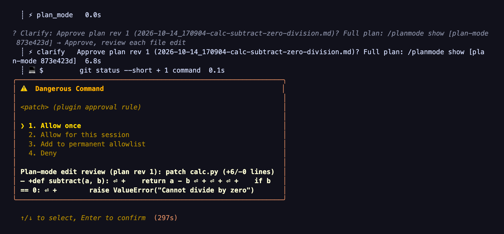
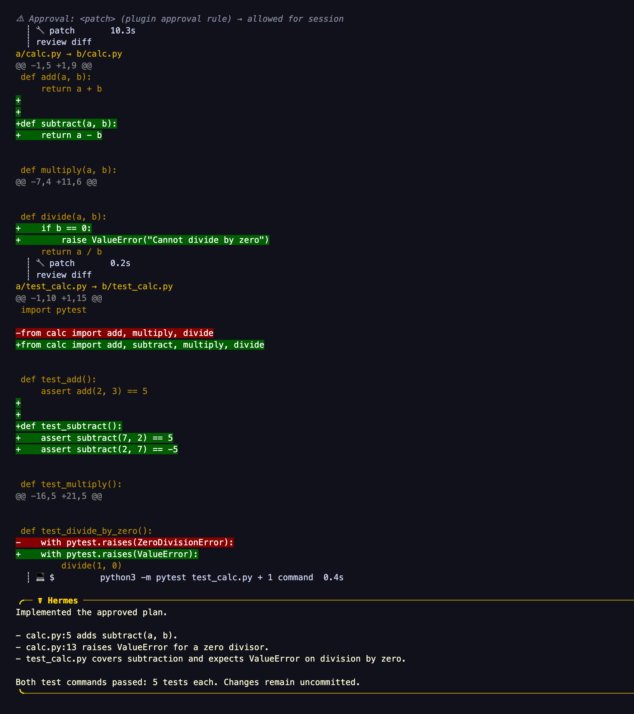
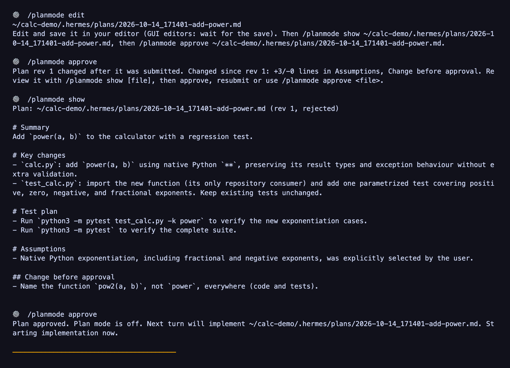
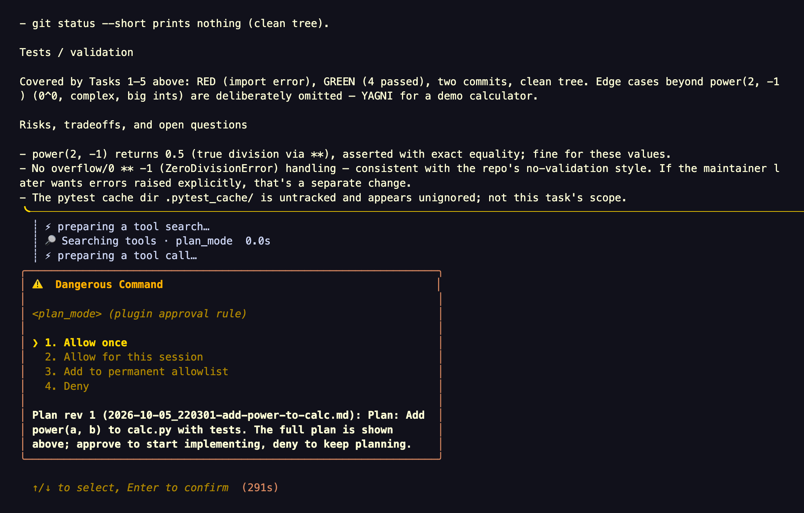

# Hermes Plan Mode


Claude Code / Codex-style plan mode for Hermes, on every interactive Hermes surface (CLI, TUI, Desktop and the
messaging platforms), with no core changes. The agent explores with
read-only tools, asks clarifying questions, writes a plan file and shows it to you. You approve it on one card:
approve and auto-accept edits, approve and review each file edit, or keep planning (Other sends feedback). The classic
profile and surfaces without a card use Hermes' own approval prompt. Then the agent implements it in the same turn and
tracks progress. Until you approve, the plugin blocks mutating tools dispatched through Hermes' `pre_tool_call`
hook, except writes to the plan file.

`/plan` in core Hermes is a prompt only. This plugin turns it into an enforced mode.

## How it works

1. Start planning with `/plan <task>` or `/planmode on [task]`. The agent can also enter on its own with the
   `plan_mode` tool.
2. The agent explores with read-only tools. For a choice only you can make, it asks with `clarify` before it writes
   the plan. With the default `lean` profile it prefers one question and asks at most three, each with 2–3 choices,
   recommended first.
3. It writes the plan as Markdown under `<cwd>/.hermes/plans`.
4. It shows the complete plan in its reply, then calls `plan_mode(action="submit")`.
5. With the default `lean` profile, plan mode asks one `clarify` card for plan revision N: "Approve, auto-accept
   edits" (recommended), "Approve, review each file edit" (only when Hermes approvals are on) or "Keep planning".
   `/planmode show` prints the plan (up to 64 KB, then a truncation notice). The classic profile, a custom `levers` list without `approval_card`, and
   ACP, API server, cron and webhooks keep Hermes' own approval prompt: buttons, a card, the CLI panel or `/approve`.
   If a turn ends while the plan still awaits approval and no card was answered, the reply ends with a line saying how to approve
   (unless `footer` is off).
6. Approve: plan mode turns off and the agent implements the plan in the same turn. It mirrors the steps into
   `todo_list` (with the default `lean` profile, for plans of 4 or more steps). With "review each file edit", every
   `write_file` / `patch` gets Hermes' approval prompt first. Typed `/planmode approve` also works while the card is
   open and selects auto-accept edits.
7. Keep planning, or Other with feedback: plan mode stays on. The agent asks what to change (when no feedback came
   with it), revises the plan and submits a complete new revision. Its card says what changed since the last one
   ("Changed since rev 1: +6/−5 lines in Summary, Key changes, Test plan").

```text
  /plan <task>  ─┐
  /planmode on  ─┼─► PLANNING ── read-only tools, clarify, write the plan file
  agent: on     ─┘        │
                          │  agent shows the plan, calls plan_mode(submit)
                          ▼
   approval card (rev N): approve / review each edit / keep planning
                   │                       │
           approve │                       │ keep planning, Other ─► revise ─► submit rev N+1
                   ▼                       │ timeout ─► /planmode approve (typed)
        EXECUTING in the same turn         ▼
        todo_list progress            still PLANNING
                   │
   all todos done, /planmode done or off ─► OFF
```

A real run on the Hermes CLI with the default lean profile (`/planmode on Add a subtract(a, b) function to calc.py
with a test, and make divide raise ValueError on zero.`), after one clarifying question:



With **Approve, review each file edit**, each file write shows its path and a preview before it applies:



The implementation then runs in the same turn (excerpt):



To change the plan yourself, choose **Keep planning**, run `/planmode edit`, save your change, then `/planmode show`
and `/planmode approve`. Approving a changed file before showing it is refused:



The classic profile (`plan_profile: classic`) approves through Hermes' own approval panel instead:



## What you see on each channel

The plugin uses the approval and `clarify` UIs each Hermes surface already has; it only sizes the approval text per
platform.

Since 0.6.0 the lean default asks for plan approval with a `clarify` card, so the "Clarifying questions" column shows
how it renders. The "Approval prompt" column applies to the per-edit review prompts, the classic profile, and
surfaces without a card.

| Surface | Approval prompt | Clarifying questions | Mode footer |
|---|---|---|---|
| CLI | approval panel with a one-line summary; the full plan is printed just above it | interactive picker | no |
| TUI / Desktop | approval card with a one-line summary; the full plan is the reply just above it | the app's question prompt | no |
| Telegram, Slack, Discord | native buttons, short summary (title + up to 6 step titles) | native buttons | yes |
| Feishu, Teams | native buttons, full plan text | numbered list | yes |
| Matrix | reactions to approve or deny, full plan text | numbered list | yes |
| WhatsApp Cloud | native buttons, plan text up to about 1000 chars (the card's limit) | native buttons | yes |
| Mattermost, Google Chat, Signal and other platforms | `/approve` or `/deny <reason>` text, full plan text | buttons where the platform has them, else a numbered list | yes |

- On Telegram, Slack and Discord the approval card has a small text budget (Discord 300 chars, Telegram and Slack
  500), so the prompt carries a ≤250-char summary. The full plan is the agent's reply sent just before it.
- Mattermost and several other platforms (for example Signal, WhatsApp Cloud and SMS) do not send the agent's in-progress text
  before the approval prompt by default. On those, and everywhere without a budget, the approval text carries the
  full plan, capped at about 3500 chars (about 1000 on WhatsApp Cloud) with a pointer to the file.
- `/planmode show` prints one complete plan up to 64 KiB; larger files show a prefix and do not arm edited-plan approval.
- **Exercised vs supported.** We have run plan mode end to end on the CLI, TUI, Desktop, `hermes serve` and Telegram.
  On Telegram the approval card's buttons were clicked (0.6.7, two runs): Hermes shows each option's text in the
  message and the buttons as `1`, `2`, `3` and `✏️ Other`. The other platforms in the table are supported through
  Hermes' own approval and question UIs, but we have not exercised them.

## Install

```bash
hermes plugins install 100yenadmin/hermes-plan-mode --ref <latest release commit sha> --enable
hermes gateway restart        # only if you run the messaging gateway
```

`--ref` takes the exact 40-character commit SHA of the latest release (see its release notes), not a tag. Without
`--enable`, run `hermes plugins enable plan-mode`. Restart running CLI, TUI and Desktop sessions so they load the
plugin.

## Commands

| Command | What it does |
|---|---|
| `/plan <task>` | Core Hermes plan prompt. With this plugin it also turns on enforced plan mode for the session (CLI, gateway, TUI and Desktop all send core's prompt). |
| `/planmode on [task]` | Fixes an absolute plans directory for this session and turns enforcement on. |
| `/planmode status` | Mode, phase (`planning`, `awaiting approval (rev N)`, `executing (rev N: <path>)`, `off`), the plans directory, plan files and the last submission. |
| `/planmode show [file]` | Displays the submitted plan (else the newest), or a named tracked file, up to 64 KiB. Complete local display records the exact reviewed text for edited-plan approval. |
| `/planmode edit [file]` | Gives the absolute tracked plan path and instructions to edit, save, show and approve it. Does not launch an editor. |
| `/planmode approve [file]` | Approves an unchanged submitted revision, or a changed/named new file after a matching complete local `show`. A reviewed replacement becomes rev N+1 once. |
| `/planmode reject [feedback]` | Keeps plan mode on and gives the feedback to the agent on its next turn. |
| `/planmode done` | Ends the executing phase (stops the progress pointer and footer). No approval effect. |
| `/planmode off` | Turns plan mode off without approving anything. |

Plan files use `<cwd>/.hermes/plans/YYYY-MM-DD_HHMMSS-<slug>.md`; the planning note hands the model the current
timestamp. Writes must use absolute paths under that directory; relative paths are rejected.

Typed `/planmode approve` keeps the submitted target; if a newer tracked file was never submitted, name it explicitly
after reviewing it. Explicit approval of an unsubmitted file also needs its own `show`. On the messaging gateway,
plugin commands run only between turns. After a
typed approval the plugin asks Hermes to start the work at once:

- CLI: works.
- Gateway and TUI/Desktop on Hermes 0.21.6 or newer: only with `allow_gateway_injection: true` (see Configuration).
- TUI/Desktop on 0.21.5 (`v2026.9.24`): not available.

When you type it while the approval prompt is still open, approving that prompt continues the waiting turn with the implementation. Denying the prompt or letting it time out does not cancel your typed approval: the work then starts in the next turn (queued where injection is available, otherwise with your next message). `/planmode done` before then cancels it.

Otherwise the reply says "Send any message to start", and your next message starts implementation.

### Editing a plan before approving

On classic CLI, TUI and Desktop, finish or dismiss any open approval first, then run `/planmode edit [file]`. Edit the
host file in your editor and wait for the save. On Desktop, open the plan file from the project tree (`.hermes/plans/`), or from
the markdown link in the agent's reply when it wrote the file itself, and use the preview's Edit and Save controls. Run `/planmode show [file]`, read the complete text, then
`/planmode approve [file]`. A file changed since submission becomes the approved rev N+1; another save between show
and approve requires showing it again. Implementation receives the captured text and a saved snapshot under
`<plans_dir>/approved/<stem>-rev<N>-<digest>.md` (a newly created file; a taken name gets a short random tag), so
later edits to the working file do not gain approval.

Files above 64 KiB do not arm approval. Chat platforms also do not arm edited-file approval because complete delivery
is unverified: use **Keep planning**, **Other**, or `/planmode reject <feedback>` for the agent to submit a new revision.
Those revision notes ask the agent to read and preserve any changes already saved to the file. This is external-file
editing with exact approval on local surfaces; it does not provide an editor inside the approval dialog.

**Telegram command menu.** Telegram's bot menu holds 60 entries by default (core commands first, then plugin
commands, then skills), so `/planmode` may be hidden on busy profiles. Typing it still works and `/commands` lists
everything. To pin it:

```yaml
platforms:
  telegram:
    extra:
      command_menu:
        priority: [planmode]
```

## The agent tool

The plugin registers one tool, `plan_mode` (toolset `plan-mode`). The profile must grant that toolset. It is on by default.
It is off on a platform when that platform's `known_plugin_toolsets` lists `plan-mode` but `platform_toolsets.<platform>`
does not, which happens when a tool selection was saved there without it. Add `plan-mode` to that list to turn it back on:

- `on`: enters plan mode for the current session, with the same checks as `/planmode on`.
- `status`: the same text as `/planmode status`.
- `off`: ends plan mode only when the agent entered it itself and has not submitted a plan yet. Once a plan is
  submitted, or when you entered plan mode, only `/planmode approve`, `reject` or `off` ends it.
- `submit` (optional `path`, `summary`): asks you to approve the plan, on the approval card or through Hermes'
  approval prompt (see How it works). The agent
  should call it on its own, not batched with other tool calls.

The tool cannot approve or reject a plan. Approval is your act, recorded by Hermes' approval hooks or the
plugin-issued `clarify` question's answer when Hermes approves automatically.

On hosts with Tool Search on (the default from v2026.9.24), plugin tools sit behind `tool_search`, which plan mode
allows. The plugin adds a short system-prompt hint (≤200 chars) naming `plan_mode` for multi-step or risky changes,
and the planning turn note tells the model to search for `plan_mode` if it is not loaded. `/plan` and
`/planmode on` stay the reliable way in.

## What is allowed in plan mode

- file exploration: `read_file`, `search_files`;
- web research: `web_search`, `web_extract`;
- skills and history: `skills_list`, `session_search`, and `skill_view` while Hermes reports `skills.inline_shell`
  off (the default);
- planning and user input: `todo_list`, `clarify`, `plan_mode`;
- Tool Search: `tool_search` and `tool_describe` (calls made through `tool_call` are checked as the inner tool);
- media and browser reads: `vision_analyze`, `video_analyze`, `browser_snapshot`, `browser_get_images`,
  `browser_vision`;
- local UI reads: `read_terminal`, `read_window_below`;
- `write_file` and `patch` only when every target is an absolute path whose real path stays inside the plans
  directory.

Everything else is blocked: terminal, code kernels, delegation, messaging, MCP and connector tools, browser
mutations, cron and kanban mutations, `memory` (it has no read-only operation), and every unknown tool.

## Configuration

In Hermes Desktop, open **Settings ▸ Plugins ▸ Plan mode**. On Hermes v2026.9.24 the same form sits inline on the
plan-mode row under **Capabilities ▸ Plugins**.

| Setting | Default | What it does |
|---|---|---|
| Enforce core /plan (`enforce_builtin_plan`) | on | Core `/plan` turns on enforced plan mode for the session |
| Agent hint (`agent_hint`) | on | The ≤200-char system-prompt hint naming `plan_mode`. It applies when Hermes next loads plugins: a new CLI process, or a restart of the gateway or app |
| Chat footer (`footer`) | `auto` | `auto` or `off`: the one-line plan/progress footer on chat platforms |
| Extra read-only tools (`extra_allowed_tools`) | none | Exact tool names you vouch for as read-only; plan mode lets them run |
| Plan profile (`plan_profile`) | `lean` | `lean`: faster, leaner compact plans (see below). `classic`: the 0.3.5 behaviour. Lean applies with Plan style `compact` and no Plan skill |
| Approval card (`approval_card`) | on | Ask for plan approval with one card in the lean profile. Off uses Hermes' approval prompt and wins over `levers` and `PLAN_MODE_LEVERS`. Change it between plans: it takes effect at once, and turning it off stops per-edit review of a running plan |
| Plan style (`plan_style`) | `compact` | `compact`: a short, decision-complete plan (Goal, Decisions, Changes, Steps, Validation), as in Claude Code and Codex. `core`: Hermes' own `/plan` craft (zero-context tasks, full code, a commit per step) |
| Allow commits (`allow_commits`) | off | Off: the agent is told not to plan or make git commits unless you ask, so changes stay uncommitted for your review. This is an instruction, not enforced (see Known limitations). On: it may commit as the plan style suggests |
| Plan skill (`plan_skill`) | none | The name of a skill whose plan format to use instead, such as your own planning contract; it wins over Plan style. When plan mode has to block `skill_view` (`skills.inline_shell` is on), Plan style is used |

### The lean profile (default since 0.4.0)

Lean keeps everything that makes plan mode safe: the approval gate, the plan file, and asking before guessing. It cuts
the rest.
- **Planning note.** It replaces core `/plan`'s ceremony with a short note: no 2–5-minute task slicing, no copy-paste
  code, and no red/green TDD steps unless you ask for TDD.
- **Plan format.** It is Codex-style: Summary; Key changes, grouped by behaviour and naming every touched file and
  every consumer of a changed interface; Test plan with exact commands; Assumptions.
- **Questions.** The agent asks only about choices that reading the repo cannot settle. It prefers one question, asks
  at most three, and gives each 2–3 choices written as label — consequence, recommended first.
- **Fewer bookkeeping calls.**
  - `todo_list` is used only for plans with 4 or more steps, and status updates ride along with real work.
  - Later planning turns get a short reminder instead of the full note.
- **Plan once (TUI, Desktop and `hermes serve`, since 0.4.1).** The agent writes the plan once, in its reply between a
  `<proposed_plan>` line and a `</proposed_plan>` line, and the plugin saves that text as the plan file. This needs
  Hermes 0.21.5 (v2026.9.24) or later with interim messages shown (and, for Codex models, commentary shown). When those
  conditions are not met, and always on the CLI and chat platforms, the agent writes the plan file as before. In round 8 (2026-10-11, plugin 0.4.1,
  gpt-6.1-sol medium, eight tasks with three runs each per arm, `plan_once` vs the 0.4.0 default)
  it was 22% faster (wall time 0.78×, 95% CI 0.73–0.85) with the same test results and judge scores.
- **Approval card (since 0.6.0).** After showing the complete plan, the agent submits and plan mode asks one
  `clarify` card: "Approve, auto-accept edits", "Approve, review each file edit" (when Hermes approvals are on) or
  "Keep planning"; Other sends feedback and starts a revision. Review covers `write_file` and `patch`, including
  file-tool calls inside `execute_code`, but not shell commands, subagents or MCP writers: once approves that edit,
  session / always the rest of this plan. Each approval gets a fresh key, so always leaves one inert config entry that
  cannot approve another plan. If approvals turn off, review pauses and edits apply without a prompt. WhatsApp Cloud
  has no Other with 3 choices. To opt out, turn **Approval card** off (`approval_card: false`); the other lean settings
  stay on. It wins over `levers` and `PLAN_MODE_LEVERS`; change it between plans, because it takes effect at once
  (turning it off stops per-edit review of a running plan, like turning Hermes approvals off). `plan_profile: classic`
  still works.
  - **PROOF-060** (2026-10-14, Hermes v0.21.6, gpt-6.1-sol medium; card vs the approval directive on two small tasks,
    4 runs each per arm):
    - Approval correctness held in both arms: one approval per scripted approve, never before it, and no writes
      outside the plans directory before approval.
    - 8 of 8 verified in both arms. The approved revision addressed the feedback 4/4 with the card vs 3/4 without.
    - Reported, not gated (medians): wall time 122 s vs 112 s (+9%), planning 89.7 s vs 82.7 s, request to approval
      25.0 s vs 22.4 s.
    - Not shown: other models, larger tasks, the TUI, chat-surface buttons, and "review each file edit" (the bench
      approves with auto-accept).
  - **What the prompts look like.** The per-edit prompt is Hermes' own approval prompt, so the host chooses its frame:
    the classic CLI shows it in the panel titled "⚠️ Dangerous Command" (once / session / always / deny), and
    Desktop shows "Approval needed" with Reject, Always allow… (Allow this session) and Run. The text inside is
    plan-mode's: the plan revision, the file and the changed lines.
  - **Cancelling the card.** On the classic CLI, Ctrl+C cancels the card (Esc does nothing there); on Desktop, Skip.
    Either way the plan stays unapproved and non-plan writes through the covered `pre_tool_call` hook stay blocked;
    ask the agent to show the card again when you are ready.
  - **Exercised by real clicks (2026-10-14, gpt-6.1-sol, Hermes v0.21.6):** classic CLI and Desktop, every choice
    (auto-accept, review each edit with once / deny / session, keep planning, Other feedback with the revision diff,
    cancel and re-ask, `/planmode show`, and the review choice hidden under `/yolo`). Not yet exercised: the TUI and
    chat platforms.
- **Other changes.**
  - The approval result includes the approved plan text.
  - Re-entering plan mode points at your previous plan.
  - "Just do it" while planning means: plan it and submit.

How 0.4.0 lean was measured against 0.3.5 classic: pre-registered lean-profile rounds with bars written before the runs
and a blind adjudicator, on eight coding tasks with the same model (gpt-6.1-sol, medium effort) and Hermes v0.21.6.
Ratios below use 0.3.5 as the denominator; these historical results do not measure current defaults.
Throughout this README, **cost-weighted tokens** means `2 × uncached input + 0.1 × cached input + 10 × output`,
with token counts in MTok (the campaign's $/MTok weights). This differs from unweighted token counts and wall time.

- Lean finished 42% faster than 0.3.5 (wall time 0.58×, 95% CI 0.55–0.62, faster on all 8 tasks).
- It used 28% fewer cost-weighted tokens (0.72×, CI 0.63–0.80).
- It had equal observed test pass counts on these tasks and no approval leaks.
- On two tasks where the user had an unstated preference, it asked and matched it in 10 of 10 runs, as 0.3.5 did. On
  the eight tasks without one it asked 15 questions against 0.3.5's 22.
- Two blind judges from different model families scored plan and code quality the same as or better than 0.3.5
  (round 3, three runs per task); the question counts above come from round 5, two runs per task.

Set `plan_profile: classic` to get the 0.3.5 behaviour back.

For a plan without a todo list, the executing reminder ends with the turn that implements it. If that turn stops
early, for example on the iteration limit, say "continue": the plan is still in the conversation and on disk.

#### Experimental levers

Lean is a fixed set of levers: `lean_craft`, `todo_batch`, `codex_compact`, `sticky`, `reentry`, `approved_text`,
`light_notes`, `question_shape`, `bridge_calls`, `blocked_tools`, `skill_policy`, `test_commands`, `choice_fidelity`,
`todo_inline`, `rename_scope`, `test_plan_only`, `approval_card` and `edit_batch` (18 levers), plus `plan_once` on TUI, Desktop and
`hermes serve` sessions, and `write_once` on the classic interactive CLI. `plan_skill` still opts into a skill's plan format. Seven more are measured but in no
profile. To try one, or to turn `plan_once` off, set `levers` to the full list you want. It replaces the profile's
set, including the automatic `plan_once` and `write_once`, so include the lean levers you want to keep:

```yaml
plugins:
  entries:
    plan-mode:
      settings:
        levers: "lean_craft,todo_batch,codex_compact,sticky,reentry,approved_text,light_notes,question_shape,bridge_calls,blocked_tools,skill_policy,test_commands,choice_fidelity,todo_inline,rename_scope,test_plan_only,approval_card,edit_batch,brief_final"
```

`levers` is not in the Settings form. The `PLAN_MODE_LEVERS` environment variable sets it when the key is unset.
- **`exec_skill_guard` (opt-in).** While an approved plan is executing, it blocks `skill_view` of the planning, TDD
  and code-review process skills, so the agent follows the approved plan instead of a per-edit test loop. A user
  message that mentions TDD, test-first, red-green or code review while plan mode is on or the plan is executing
  lifts the block for TDD and code-review skills; planning, brainstorming and executing-plans skills stay blocked.
  A configured `plan_skill` turns the guard off.
  PROOF-050 (2026-10-13, HP with vs without the guard, two PARITY-4 tasks, 4 runs each per arm) is why it stays
  opt-in:
  - The guard blocked the skill in the one lever run that asked for it, and no lever run loaded a process skill.
  - Results were unchanged: 8 of 8 verified in both arms.
  - The speed effect was not shown, because the control loaded the TDD skill in only 2 of 8 runs.
- **How the 0.4.4 levers were decided.** With all five on (S44), the set cut passing tests on the refactor task (T8)
  below the pre-declared guard, 33.5 → 26.25 per run, and a fresh replication confirmed it (29.1 → 22.3), so 0.4.4
  kept them all opt-in. The 0.4.5 stress (S45, gpt-6.1-sol, 26 runs per arm) then tested the three planning levers
  without the two execution levers. Every guard held, including T8 tests (24.9 vs 28.4 per run, above the 85% bar),
  and two levers joined lean. A labelled third arm ran the two execution levers alone: in that arm, mean passing tests
  per run rose on T7 (14.3 → 18.3) and T8 (28.4 → 32.3). The earlier drop was observed with all five enabled (#26).
- `rename_scope` (lean since 0.4.5) tells the model to keep a rename's behaviour and assertions and to search the whole
  repo, naming plan files as expected matches. Rename plans that narrowed the leftover search fell from 4 of 4 to 0 in
  both S44 and S45, and plans adding an unrequested assertion from 3 to 0 in S45.
- `test_plan_only` (lean since 0.4.5) tells the model to leave git status, git diff and other repo-hygiene checks out of
  the test plan unless asked. Plans with them fell from 10 of 26 to 0 in S45 (7 of 22 to 0 in S44).
- `choice_record` (opt-in) tells the model to record answered clarify choices in Assumptions as the user's decision.
  With it, 6 of 6 plans did so in S45. Without it, the probe counted 2 of 6, but read directly 4 of 6 already
  attributed the choice to the user, so the deficit the lever targets was not shown and it stays opt-in.
- `edit_batch` (lean since 0.6.7) tells the model to edit each file in one call where the tool allows, and to send
  edits to different files, including tests, in the same response. Execution rounds with edits fell from 49 to 27 on
  the two edit-heavy tasks in S45 (48 to 20 in S44). It joined lean after EB-2 (2026-10-14, pre-registered, decided by
  a blind adjudicator): 0.6.6 lean with vs without it, on T8 × 8 and on PARITY-4's N1 and L2 × 4 each per arm, same day,
  same harness, HP only, three tasks, gpt-6.1-sol. Results:
  - 16 of 16 runs verified in both arms;
  - T8 passing tests per run 27.5 vs 26.375 (1.04×, guard ≥ 0.85×);
  - execution model calls per run 7.9 vs 11.8 (0.67×, 95% CI 0.56–0.81);
  - execution cost-weighted tokens 0.94× (95% CI 0.75–1.18).

  EB-2 used medium effort; its ratios use the 0.6.6 lean arm without `edit_batch` as the denominator and the
  cost-weighted definition above.

  The first run of the same test, EB-1, was not counted for the decision. One run's call count included a Hermes
  background-review call, which made the call and cost bars undecided; its results and T8 bars held. #26 has both.
- `brief_final` (opt-in) tells the model to finish in 2–4 lines with what changed and the test result. The median final
  reply fell from 128.5 to 64 output tokens in S45 (117.5 to 62.5 in S44).
- Speed is labelled, not gated: S45's arm with the three planning levers (`rename_scope`, `test_plan_only`,
  `choice_record`) took 1.11× the baseline's wall time (95% CI 0.97–1.25).
- `test_commands` (lean) tells the model to write test commands the way the repo runs them, falling back to
  `python3 -m pytest` for an undocumented Python repo. In the 0.4.3 stress, plans naming a bare `python` fell from 18
  of 18 to 0, and so did runs that spent a round retrying the command (17 of 18 to 0).
- `todo_inline` (lean) tells the model never to call `todo_list` in a response by itself: create the list with the
  first edit, update it alongside the next edit or test, and close it with the final test run. Rounds spent only on
  the todo list fell from 27 to 7.
- `choice_fidelity` (lean) tells the model that a recommended clarify choice must keep every stated requirement. On
  the CSV task, plans that exempted NaN and Infinity from the required round trip fell from 2 of 6 to 0.
- `refactor_scope` (opt-in) tells the model to keep a rename's behaviour and assertions, and to search the whole repo
  for leftovers. S43 first scored it as missing its bar; that was a probe error (the probe matched the plan naming its own file).
  Re-scored, narrowing went 4→0 of 4 and unrequested asserts 3→0 (#24). It stays opt-in because its "add no new test cases"
  clause may cut tests on refactors that ask for them; `rename_scope` is the rename-only form.
- `bridge_calls` now also gives the agent hint and the agent-entered result the `tool_call` form, so the agent can
  enter and leave plan mode without a tool search (#22).
- `plan_budget` asks for compact plans of under about 1,200 characters for small changes. In its pre-registered round
  it halved plan length and finished 24% faster, but one judge scored plan clarity lower.
- `commit_override` adds "This overrides any commit step in a loaded skill" to the no-commit rule
  ([#18](https://github.com/100yenadmin/hermes-plan-mode/issues/18)). In round 8 neither the default nor the lever
  committed when the task asked for TDD (0 of 12 each), so its effect is unmeasured.
- `approval_ask` tells the agent to ask the approval question even when you said not to ask questions, where Hermes
  approves plugin calls automatically ([#19](https://github.com/100yenadmin/hermes-plan-mode/issues/19)). In round 8
  the question came unprompted in the first turn in 6 of 8 runs with it and 7 of 8 without; in the other runs it
  came after one nudge.
- `plan_once` (in lean on TUI, Desktop and `hermes serve`): Hermes reads `display.show_commentary` when it builds the
  agent, so after changing that setting start a new session before relying on `plan_once`. The approval card shows
  the saved plan up to 3,500 characters.
- `write_once` (in lean on the interactive classic CLI): the agent writes each plan revision to a new file, Hermes
  prints it in full as an inline diff, and the agent skips retyping it when the plugin can confirm the diff showed the
  whole file (see Compatibility). In SPEED-2 (pre-registered, 12 runs on two PARITY-4 tasks, #30) it cut planning output
  tokens to 0.65× with the same number of model calls and the same plan length, and two blind judges found no worse
  plans. Planning was not faster: the pre-registered planning-time gate failed (0.94×, bar 0.90×). It joins lean on the
  owner's metric, plan quality and tokens; wall time is reported, not gated.

### Compact plans

Compact plans without commits are the default since 0.3.5. In an end-to-end comparison on eight coding tasks (same
model, blind judge, one run per task), compact plans were about half as long as core's and every task still passed its
checks. The judge scored plan fit plus clarity 10.0 of 10, against 8.9 for core. Median time per task fell from 194 s to
151 s, and token use was about the same. Set `plan_style: core` and `allow_commits: true` to get the 0.3.4 behaviour back.

Or set them in the profile's `config.yaml` (flat keys under `settings`):

```yaml
plugins:
  entries:
    plan-mode:
      allow_gateway_injection: false    # true: typed /planmode approve starts work at once on gateway/TUI
      settings:
        enforce_builtin_plan: true
        agent_hint: true
        footer: "off"                   # quote it: a bare off is read as false (also honored)
        extra_allowed_tools: []
        plan_profile: lean              # or classic (0.3.5 behaviour)
        plan_style: compact             # or core
        allow_commits: false
        plan_skill: ""                  # e.g. durable-plan-contract
```

- `extra_allowed_tools` is an explicit policy override: the operator vouches that those tools are read-only.
- `allow_gateway_injection` is a core Hermes setting, outside `settings`, so it is not in the form. It lets this
  plugin queue a message into a gateway or TUI/Desktop session; the plugin uses it only to start implementation
  after a typed `/planmode approve`.
- The nested `settings.plan_mode.<key>` layout from earlier versions is still read when the flat key is unset, but
  the form shows only flat keys: move old values up one level so the form and the plugin agree.

## Compared with other plan modes

| | Claude Code | Codex | Hermes `/plan` | plan-mode 0.6.0 |
|---|---|---|---|---|
| Writes blocked except the plan | yes | prompt only | no | yes, for tools that pass `pre_tool_call` |
| Approval prompt after the plan | dialog | "Implement this plan?" | no | a `clarify` card (lean default) or Hermes' approval prompt, every interactive surface |
| Clarifying questions | AskUserQuestion | request_user_input | not prompted | `clarify`, prompted |
| Deny with feedback, revise | yes | yes | no | yes; Other on the card, gateway `/deny <reason>`, otherwise the agent asks |
| Implement after approval | same turn | one click, as a new turn | no | same turn via the prompt; typed approve may need a message |
| Progress | Tasks / TodoWrite | update_plan | `todo_list` | `todo_list` + footer on chat platforms |
| Agent may enter | yes | no | no | yes |
| Autonomy choice / clear context at approval | yes | partial | no | auto-accept or review each edit; no clear context |

### Measured against Codex plan mode

Four pre-registered benchmarks, PARITY-1 to PARITY-4, compared plan-mode with Codex's own plan mode.
- **Freezing and judging:** the bars were written and hashed before any run, and a blind adjudicator applied them,
  seeing only the bars and the measurements.
- **Setup:** both products ran the same model (gpt-6.1-sol, medium) with the same scripted user. PARITY-1 to PARITY-3
  used a suite of Python coding tasks, two of which hide a preference that only the user knows. PARITY-4 used four
  larger tasks.
- **Reading the metrics:** each campaign below names its historical plugin version, not the current release. PARITY
  ran the lean defaults for that version. Ratios in this section use Codex plan mode as the denominator: wall time
  is elapsed time for the named phase; raw token use counts input and output without price weights; cost-weighted
  tokens use `2 × uncached input + 0.1 × cached input + 10 × output`, per MTok. PARITY-1 to PARITY-3 had 38 runs per
  product, with test checks on 35 and hidden-preference checks on 10. Judge percentages use blind plan pairs as the
  denominator, not finished-code correctness; pair counts not stated below are not given in this summary.

**plan-mode 0.4.5 (PARITY-3, 2026-10-13).** Against Codex plan mode on the same model, suite and test environment,
plan-mode 0.4.5 met every threshold (0 non-plan repository changes before approval in 38 runs; tests passed in 35 of 35
runs for each product; hidden preferences found in 9 of 10 runs, against 10 of 10 for Codex; judge preference 82%
Claude, 82% Codex) and took 1.61× as long end to end on the core tasks of this Python suite (95% CI 1.33–1.79): 1.40×
in planning and 1.65× in execution.
- 0 commits before approval, and every approval went through the gate.
- One of plan-mode's 9 hidden-preference hits came from a question that named no options. The scripted user's
  default answer happened to match, so asking quality on that task is unproven.
- The judges compared plans blind, plan text only: 95% CI 71–91% for the Claude judge and 76–86% for the Codex judge.
- Both products ran the same `python3` (3.9.6) and pytest (8.4.2), checked for both before and after the campaign.
  During the runs only Codex's command output was recorded, so for plan-mode the in-run check was not observed.
- 0.4.5's two new lean levers held: 0 of 3 rename plans narrowed the leftover check or added an unrequested assertion,
  and 0 of 38 plans had git status or diff checks (the S44 probes).
- On the rename task, the Codex judge preferred Codex's plan in 3 of 3 pairs: plan-mode's plan names plan files as
  expected matches of the leftover search, which that judge read as permitting old names (#28). The Claude judge
  preferred plan-mode's plan in 2 of 3.

**Larger tasks (PARITY-4, 2026-10-13).** On four larger tasks (a static site generator, a JSON API, a Node.js CLI and a
refactor across a ~200-file repo), plan-mode 0.4.5 met every threshold against Codex plan mode on the same model
(plan-mode verified 12 of 12 runs, Codex plan mode 12 of 12) and took 1.82× as long end to end (95% CI 1.52–2.18×),
1.73× in planning and 1.96× in execution.
- **Before approval:** 0 non-plan repository changes and 0 commits in 12 runs, and every approval went through the gate.
- **Correctness:** both products finished every run, so these tasks do not separate them on correctness.
- **Plan quality:** in blind plan-only comparisons, the Claude judge preferred plan-mode's plan in 92% of pairs (95% CI
  75–100%) and the Codex judge in 83% (67–100%).
- **The refactor** hides four code paths that use the changed events.
  - plan-mode's plans named all four in 3 of 3 runs.
  - Codex plan mode's plans named one in one run and none in the other two.
  - Both products' finished code handled all four.
- **Raw token use:** plan-mode made more model calls (a median of 14–34 per run, against 10–13) and used 1.2–5.3×
  the unweighted tokens across the four tasks (12 runs per product).
  Its calls were not slower: the median was 7.4 s per call (297 calls), against 12.3 s per Codex request (87 requests;
  49 requests with no recorded end were left out).
- **Test environment:** both products ran the same `node` (v26.7.0), `python3` and pytest, and command output was
  recorded for both. No run showed a missing node or pytest.
- **One rule changed after the smoke run and before the counted runs:**
  - The original node check accepted only a literal `node --test` command with its own exit status, but both products
    ran node through `npm test`.
  - The amended rule also accepts `npm test` and a passing node:test summary. It was frozen and re-checked blind before
    any counted run.
  - Under the original rule, the campaign would have stopped before it started.

**Revisions (REV-1, 2026-10-15).** When the user sent the first plan back with a change, plan-mode 0.6.8 and Codex plan
mode had equal observed pass counts on these tasks. Both ran on the same model (gpt-6.1-sol, medium), on the same day, with 6 runs per task and
product on two tasks. Plan-mode used its lean defaults. The bars were pre-registered and applied by a blind adjudicator.
- **Setup:** the scripted user denied the first plan with one change request, then approved the revision.
  - T6: give `slugify` a docstring with two examples and return `""` for `None`.
  - T7R: add `import --dry-run`, which prints `would import N rows` and writes nothing.
- **Change applied in the finished code:** 12 of 12 for plan-mode, 12 of 12 for Codex plan mode. A column-blind
  reviewer judged the T6 docstrings.
- **Original task still correct:** 12 of 12 for each.
- **Cost of the revision round** (from the feedback to the next plan decision): plan-mode used 1.75× Codex's
  cost-weighted tokens (95% CI 1.52–2.02).
  - Most of the difference is output. plan-mode writes the complete revised plan and submits it in a second call: a
    median of 2 calls and about 1,350 output tokens per round, against 1–2 calls and about 460 tokens for Codex.
  - Whole runs cost 1.46–1.57× Codex's cost-weighted tokens.
  - Median wall time was 94 s against 51 s (T6) and 207 s against 110 s (T7R). Wall time is reported only.
- **A first run of the Codex column was not a fair comparison and is not used.** It ran without the shared Python user
  site that PARITY-3 and PARITY-4 used, so Codex's `python3` had no pytest.
  - Codex then lost 4 of 6 T6 runs to a type annotation that fails on the repository's Python 3.9. It had checked
    that code only under Python 3.12.
  - That run is kept in the evidence (Codex 8 of 12).
  - The Codex column was then re-run with the user site, under a declaration written before the re-run. That re-run
    gives the numbers above.

**plan-mode 0.4.2 (PARITY-2, 2026-10-12).** It met every pre-declared threshold.
- 0 non-plan repository changes through the covered `pre_tool_call` hook and 0 commits before approval in 38 runs,
  and every approval went through the gate.
- Tests passed in 35 of 35 runs, against 35 of 35 for Codex.
- The hidden preference was found before the plan was submitted in 10 of 10 runs, against 10 of 10.
- In blind plan-only comparisons, a Claude judge preferred plan-mode's plan in 91% of pairs (95% CI 82–100%) and a
  Codex judge in 88% (82–94%).
- It took 1.28× as long as Codex end to end (95% CI 1.16–1.40): 1.35× in planning and 1.26× in execution.
- Compared with 0.4.1, the runs that spent rounds on things that buy nothing fell:
  - `plan_mode` lookups: 38 of 38 → 0;
  - blocked command attempts: 36 of 38 → 0;
  - process-skill loads while planning: 30 of 38 → 1.

**plan-mode 0.4.1 (PARITY-1, 2026-10-12).** It met the same thresholds:
- tests 35 vs 35 of 35;
- hidden preferences 9 vs 10 of 10;
- judge preference 86% (Claude) and 89% (Codex).

It took 1.45× as long (95% CI 1.31–1.63).

Claude Code (Opus 5.5, a different model) is shown for context only:
- It was fastest, with a median 27 s on the core tasks against 56 s for Codex and 80 s for plan-mode 0.4.1.
- It asked no clarifying questions, so it found 0 of 6 hidden preferences.
- The judges split on its plans: the Claude judge preferred Claude Code's plans in 14 of 14 pairs, and the Codex
  judge preferred plan-mode's in 64%.

**What these runs do not show.**
- **PARITY-3 recorded higher per-call latency than PARITY-2; the cause is not isolated.** plan-mode made fewer model
  calls than in PARITY-2 (350 vs 410), with similar median sizes (about 21k tokens in and 110 out per call), but its
  median wait per call was 8.8 s against 4.3 s. Codex's run times rose too, and one Codex judge call was refused with
  "model at capacity" and re-judged under the test plan's judge-rerun rule. Codex's per-call latency is not recorded, so
  how much of the 1.61× comes from the product and how much from the API that day is not measured.
- **In PARITY-1 and PARITY-2 the test environments differed.** Both products ran the same `python3`, but only
  plan-mode's could import pytest: it saw the user's site-packages, and Codex ran with a clean home. In PARITY-2, every
  Codex run's `python3 -m pytest` failed while planning, 36 of 38 then ran tests through `uv run --with pytest` with an
  approval, and 30 of 38 Codex plans said pytest was missing. A re-analysis (2026-10-13) estimates that without that
  setup cost the execution ratio would be about 1.39–1.42× rather than 1.26×, so the published ratios flatter plan-mode.
  This is an estimate (3 runs per task, most of the shift from one task). The judges saw the "pytest missing" text in
  Codex's plans; there is no sign it moved their scores. PARITY-3 gave both products the same environment.
- **Codex runs read-only shell commands while planning;** plan-mode blocks the terminal until approval. In PARITY-3,
  Codex ran shell commands and tests before approval in 38 of 38 runs, and plan-mode in 0. Both are measured as
  shipped.
- **Not covered:** other models, chat platforms, long sessions, repos much larger than ~200 files, multi-hour tasks,
  most non-Python work (PARITY-4 had one Node.js task), and the time a person takes to review a plan.

## Security model

- **Enforcement covers tools dispatched through `pre_tool_call`.** Tools that bypass that hook are not covered (see
  Known limitations). Any exception in the plugin's active `pre_tool_call` blocks the call.
- **Approval is a human decision.** A submit asks Hermes to approve under a rule key unique to that plan revision
  (`plan-mode:<activation>:<rev>:<digest>:<nonce>`). A prompt approval counts only when Hermes'
  `post_approval_response` hook reports, for that exact key and tool call, the choice once, session or always,
  without a cancel. A plugin-issued `clarify` answer or typed `/planmode approve` is also a human path. The tool has no approve action, so the model
  cannot approve its own plan.
- **A submitted plan belongs to you.** After a submit, the agent can no longer turn plan mode off, even if it entered
  plan mode itself; a denial, a timeout or a missing human decision leaves the decision with you.
- **No human, no approval.** With yolo or `approvals.mode: off`, Hermes approves the call without asking and fires no
  hook. The plugin keeps plan mode on and asks through `clarify`: buttons on Telegram/Discord/Slack, a card on
  Desktop/TUI, a CLI prompt, or a numbered list elsewhere. Only the answer to that exact plugin-issued question
  (or typed `/planmode approve`) approves the unchanged plan. Approval comes from your clarify answer, not Hermes'
  approval prompt. **Approve plan rev N** starts implementation in the same turn; **Keep planning** or free text
  sends the plan back for revision. If `clarify` is unavailable, use `/planmode approve`. A host that ignores the
  approval directive uses the same fallback.
- **"Always" behaves like once for plans,** because each revision has a new key. Hermes core still writes a
  `plugin_rule:plan-mode:…` entry to `command_allowlist` in `config.yaml` for every "Always". You can delete those
  entries.
- **The approval prompt is Hermes' generic one.** It is worded for commands (the CLI panel is titled "Dangerous
  Command"; gateway cards say Hermes wants to run a command), and it times out after 300 s by default
  (`approvals.timeout`). A timed-out or withdrawn prompt leaves the revision awaiting approval; `/planmode approve`
  still works for it.
- **Gateway `/approve` is not plan-specific.** Plain `/approve` resolves the oldest pending prompt, and `/approve all`
  approves everything pending, plans and commands alike.
- **Deny reasons exist only on gateway text `/deny <reason>`.** Buttons, the CLI panel and the TUI/Desktop card deny
  without a reason. The agent then asks what to change. Core also tells the model "Do NOT retry" on any denial; the
  plugin's turn note tells it that a plan denial is review feedback.
- **An edited plan needs a fresh review.** The plugin hashes the plan at submit. A card/prompt approval refuses if the
  file changed; typed approval of an edited or explicitly named unsubmitted file requires a complete local
  `/planmode show [file]` followed by a matching activation, path and fresh digest. The same captured text is approved
  and saved as a snapshot, independently of the `approved_text` lever. A summary or truncated display never arms it.
  When the card's submitted text is available, the refusal includes a bounded change summary.
  If the newest tracked file differs from the submitted file, bare approve names it and refuses because it was never
  submitted; ask the agent to submit it or review it with `/planmode show` and approve it explicitly. An unchanged
  submitted revision can still be approved after a denial or timeout.
- **One prompt at a time.** A second submit while an approval prompt is open is blocked. A typed `/planmode approve`
  while the prompt is still open approves the unchanged submitted revision when it is still the newest tracked file,
  and the prompt's later answer changes nothing. Revised-plan approval requires finishing or dismissing that prompt first.
- **`/plan` marker.** The plugin detects core's `/plan` prompt in the user's message. A user who types that text only
  restricts their own session; the model cannot author the user's message. If activation is refused (no session
  identity, profile mismatch), `/plan` stays prompt-only for that turn. If the hook times out, Hermes continues the
  turn without it, so enforcement may start late (when the delayed call finishes) or not at all for that turn.

## Known limitations

- **The agent can skip the approval card** when you say not to ask questions
  ([#19](https://github.com/100yenadmin/hermes-plan-mode/issues/19)); the turn-end `/planmode approve` pointer is the fallback.
- **Codex app-server runtime.** Hermes' Codex app-server executes native `exec` and `applyPatch` outside
  `pre_tool_call`. Plan mode does not enforce them. Use a normal Hermes tool runtime when enforcement matters.
- **TUI `/background` and `btw`** side agents run under their own task id with no public link to the parent session.
  They keep full tools while the parent chat is in plan mode.
- **Argument-rewriting plugins.** Another plugin's `modify` directive can rewrite arguments after this plugin checked
  them. Avoid combining them on plan writers.
- **Plan-root race.** The plugin revalidates `.hermes` and `.hermes/plans` before each plan write, but does not own
  Hermes' eventual file open. Do not let other processes change the plan root during plan mode.
- **TUI profile scope.** If the TUI resolves the command in a different profile than the session, the plugin refuses
  `on`, `off`, `approve`, `reject`, `done`, `show` and `edit`. Two live sessions sharing one session key in one TUI backend cannot be told
  apart; keep session keys unique per profile.
- **Session-key edge cases.** With `compression.in_place: false`, `/planmode on` then `/compress` before any agent
  turn is unsupported. On the gateway, `/planmode on` then `/new` before any agent turn keeps plan mode on in the new
  chat; run `/planmode off`. In a second TUI/Desktop tab of the same profile, `/planmode on` may be refused while a
  linked tab has plan mode on; retry from the owning tab after one turn there.
- **Resuming an approved plan.** Durable resume is not part of 1.0
  ([#6](https://github.com/100yenadmin/hermes-plan-mode/issues/6)).
  - **Hermes restart:** classic CLI execution state belongs to its process ID and is cleared on normal exit; a new
    CLI process does not recover its execution pointer. Other surfaces can read retained state only when their
    session/tab key still resolves it; there is no automatic unfinished-step recovery.
  - **Context compaction:** while execution state is still found, a reminder asks the agent to re-read the approved
    plan (its snapshot when present). Progress stores counts and a short current-item label, not a full checkpoint.
    Lean clears the reminder at turn end without a nonempty todo list; a surviving reminder also expires after 100 executing turns.
  - **TUI/Desktop key rotation or reopening:** the same tab can keep its pointer after a key rotation, but new keys
    are not linked while executing. Commands in the new key or a reopened tab may miss it; `/planmode done` may leave
    the old pointer behind.
  - **Workaround:** run `/planmode status`. To clear a stale reminder, try `/planmode done` in the session/tab where
    status still identifies it. Open the saved file under `.hermes/plans` if `/planmode show` cannot find it, then tell the agent:
    "Read this approved plan: <file> (use its approved snapshot if available). Check what is already complete and
    continue only the unfinished work; ask me before changing the plan." If status says planning is on, have the
    agent submit the remaining plan and approve it again before edits. This is manual continuation, not restored progress.
- **The no-commit rule is an instruction.** After approval plan mode is off, and terminal commands are not inspected.
  In benchmark runs the agent committed in 3 lean runs (2 of 108 through round 7, 1 of 112 in round 8), each after
  loading a TDD skill that commits per step, and in 0 of 70 classic runs
  ([#18](https://github.com/100yenadmin/hermes-plan-mode/issues/18)).
- **Plan once shows its tag lines.** On TUI, Desktop and `hermes serve` the reply shows the plan between a literal
  `<proposed_plan>` line and a `</proposed_plan>` line; Hermes does not style them as Codex does. Desktop's history view
  folds the planning reply away after the turn; the plan file stays in `.hermes/plans`.
- **Approval choices cover file tools:** the lean card offers auto-accept or review each `write_file` / `patch`
  when Hermes approvals are on (see The lean profile). It does not offer **clear-context-and-implement**
  (not reachable from a plugin).
- **No live mid-turn plan or progress card.** Progress shows as a footer at the end of each reply. A live card needs
  a new upstream plugin API, proposed in
  [NousResearch/hermes-agent#133306](https://github.com/NousResearch/hermes-agent/issues/133306) together with
  plan-shaped approval wording.
- **Footer limits.** Chat platforms only: never CLI, TUI, Desktop (also not for a chat session resumed in Desktop),
  API server, webhook, cron or delegate subagents. Only on replies of 1800 chars or fewer, because adding a footer to
  a longer streamed reply could re-send part of it. The approval pointer applies on every resolved surface regardless
  of reply length, so on a long streamed chat reply it may re-send that reply's last part. `footer: off` turns off
  both the footer and the pointer, and the pointer never goes to subagent or curator turns.
- **Other output transforms.** Hermes runs every plugin's `transform_llm_output` but uses only the first returned
  text. While the footer or the approval pointer shows, another plugin's transformed reply (for example a redactor's)
  may be discarded; set `plan_mode.footer: off` if you rely on one (this also turns off the pointer).
- **Telegram, Slack and Discord approval text** is a short summary; the full plan comes from the agent's reply or
  `/planmode show`.
- **Duplicate submits on hosts without tool call ids.** Hermes builds that pass no `tool_call_id` to hooks cannot
  tell a blocked duplicate submit from the open one; every supported build passes it
  ([#6](https://github.com/100yenadmin/hermes-plan-mode/issues/6)).

## Compatibility

- **Classic CLI:** enforced on Hermes 0.21.3 (`v2026.9.14`) and newer; the plugin requires 0.21.3.
  With `write_once` (lean, interactive classic CLI only), the agent writes each plan revision to a new file with
  `write_file`, and the CLI prints the new file as an inline diff. The agent skips retyping the plan only when the
  plugin can confirm that diff showed the whole file it is submitting: inline diffs on, a local file backend, at most
  78 lines, no control characters and no line starting with `++ `. Otherwise it shows the plan as before. Single-query
  mode (`hermes chat -q`) never qualifies. Approval is unchanged.
- **Messaging gateway, TUI and Desktop:** Hermes 0.21.5 (`v2026.9.24`) or newer. Earlier builds refuse
  `/planmode on` on these surfaces instead of pretending plan mode is active.
- **0.21.6 recommended.** On 0.21.5, turning a tool-providing plugin on from Desktop, the TUI or the dashboard can
  replace the CLI tool set with that plugin's tools when no tool list was saved (fixed in 0.21.6). On 0.21.5, enable
  plan-mode with `hermes plugins enable plan-mode` or in `config.yaml` instead.
- **v0.3.0 features** use only the Hermes capability they need. Where the approval directive or the approval hooks
  are missing, submit asks through `clarify`, with typed `/planmode approve` as the fallback if clarify is unavailable. The system-prompt hint is skipped where the host
  has no prompt-section API, and typed approval skips `inject_message` where the host has none.
- Tested in CI against Hermes `v2026.9.14`, `v2026.9.21`, `v2026.9.24` (Python 3.11), `v0.21.6` and a
  pinned `main` (Python 3.14, the version for which 0.21.6 and `main` declare their runtime dependencies).

## How to test

```bash
hermes plugins validate .
pytest -q
```

Manual walkthrough in a disposable workspace (full surface-by-surface list in
[`docs/manual-test.md`](docs/manual-test.md)):

1. Run `/plan add a hello-world script`. Ask for `pwd` or a file write outside the plans directory; both are blocked.
2. Let the agent write the plan, show it and submit. Hermes' approval prompt appears with plan rev 1.
3. Deny. Plan mode stays on; the agent asks what to change, revises and submits rev 2.
4. Approve. The agent starts implementing in the same turn and fills `todo_list`; on a chat platform the reply ends
   with `Plan progress n/m`.
5. Run `/planmode status`: phase `executing`. Finish the todos or run `/planmode done`; status reports `off`.

## Disclosure

Disclosure — plan-mode blocks mutating Hermes tools dispatched through `pre_tool_call` (not Codex app-server
`exec`/`applyPatch`, not TUI `/background` or `btw` side agents) until the user approves a plan: on its approval card
(a `clarify` question only the plugin issues and checks), through Hermes' own approval prompt (classic profile and
surfaces without a card), or with `/planmode approve`. It reads nine groups of internal Hermes seams for session identity, workspace,
profile, `skills.inline_shell` and the classic CLI's inline diff, each guarded, with the fallbacks listed below. It creates `<cwd>/.hermes/plans`, reads plan
files there, saves the approved text of an edited plan as a new file under `.hermes/plans/approved/`, and keeps
per-session state in plugin state. It adds a turn note while planning or executing, a
≤200-char system-prompt hint, and a one-line footer to short replies on chat platforms. When a turn ends while a submitted plan still awaits approval and no approval card was answered, it adds one line to that reply on any surface, whatever its length, saying how to approve (unless `footer` is off). On TUI, Desktop and
`hermes serve` sessions (lean profile, `plan_once`) it reads the agent's visible reply text while planning and saves
the `<proposed_plan>` block from it as the plan file. On the interactive classic CLI (lean profile, `write_once`) it
checks that Hermes printed a newly written plan file in full and then tells the agent not to retype it. When the user picks
"Always" on a plan approval or a per-edit review, Hermes core writes a `plugin_rule:plan-mode:…` entry to
`command_allowlist` in `config.yaml`; each key belongs to one plan revision, so the entry cannot approve another plan. With `allow_gateway_injection: true` it queues one message to start work after a typed approval. It
includes a report-a-problem skill: the agent drafts a bug report and files it to this repository with `gh` only after
the user approves the draft. The plugin itself makes no network calls, launches no subprocesses and has no self-updater.

<details>
<summary>Internal Hermes seams read</summary>

Each is reached through a lazy, guarded import or a guarded attribute read.

1. `gateway.session_context.get_session_env`: session identity and platform. Missing → `/planmode on` refuses and
   nothing blocks.
2. `gateway.session_context.session_context_engaged`: whether this process bound a server session. Missing → treated
   as never engaged.
3. Gateway admission: `HERMES_GATEWAY_SESSION` and `gateway.run._gateway_runner_ref` (only if already imported).
4. `agent.runtime_cwd.resolve_agent_cwd`: the turn's workspace. Missing → an absolute `TERMINAL_CWD`, or the classic
   CLI process cwd.
5. `hermes_cli.profiles.get_active_profile_name`: the registration profile. Missing → bound sessions refuse every
   state-changing command and `show`.
6. `agent.skill_preprocessing.load_skills_config`: whether `skill_view` would run inline shell. Missing or odd →
   `skill_view` blocked.
7. `ctx._manager.home_path`: the Hermes home the plugin registered from. Missing → bound sessions refuse every
   state-changing command.
8. `plan_once` only: `tui_gateway.server` (only if already imported) and its `_active_config_path`, read with
   `hermes_cli.config.require_readable_config_before_write`, `hermes_cli.config_effective.load_user_config_effective`
   and `utils.is_truthy_value`, to check that interim messages and commentary are shown; then
   `agent.history_commentary`, `agent.agent_runtime_helpers.strip_think_blocks` and
   `agent.message_sanitization.coalesce_tool_call_id` to take only the visible reply text. Any of them missing or
   failing → the agent writes the plan file as without `plan_once`.
9. `write_once` only: `ctx._manager._cli_ref` (the seam `ctx.dispatch_tool` uses) and its `_single_query_mode`; the
   CLI agent's `tool_start_callback` and `tool_complete_callback`, which must be the CLI's own `_on_tool_start` and
   `_on_tool_complete` (Hermes sets them only while `display.inline_diffs` is on); `TERMINAL_ENV`, which must be
   local; and `agent.display._MAX_INLINE_DIFF_LINES`. Any of them missing or different → the agent shows the plan as
   without `write_once`.

Public hooks used: `pre_tool_call`, `post_tool_call`, `pre_llm_call`, `post_llm_call`, `post_api_request`,
`transform_llm_output`, `transform_tool_result`, `pre_approval_request`, `post_approval_response`,
`on_session_reset`, `on_session_finalize`. Public context APIs:
`ctx.state`, `ctx.inject_message`, `ctx.register_system_prompt_section`, `ctx.register_skill`.

</details>

## Troubleshooting and reporting a bug

Run `/planmode status` in the affected session to check mode, phase and the plans directory.
The agent can read the same state with `plan_mode(action="status")`.
Ask your Hermes agent to "report a problem with Plan Mode". It uses the plugin's `plan-mode-report-problem` skill:
it checks status, drafts the report, shows it to you and files nothing without your yes. Hermes 0.21.6 and newer list
the skill for the agent; on older Hermes, ask it to load the `plan-mode:plan-mode-report-problem` skill by name.
While plan mode is on, shell commands are blocked, so the agent gives you the draft and the form link instead of filing.
Use the [bug report form](https://github.com/100yenadmin/hermes-plan-mode/issues/new?template=bug_report.yml) and include plugin/Hermes versions and the affected surface.
For log excerpts, try `hermes logs -n 300 | grep -iE 'plan[-_]mode'`, and `hermes logs errors` for warnings. Hermes names this plugin `plan-mode` and its tool `plan_mode` in its logs; the plugin has no logger of its own, so expect only a few lines.
Remove secrets, private message text and private paths before sharing diagnostics or logs.
Report approval bypasses or writes outside the plans directory through a [private advisory](https://github.com/100yenadmin/hermes-plan-mode/security/advisories/new).

## License

MIT. Maintained by [100yenadmin](https://github.com/100yenadmin).
